<p align="center"></p>

<h3 align="center">A generative step sequencer and synth for the M-VAVE FM-1</h3>

<p align="center">
  <a href="https://joakimskurk.github.io/fm1mello/">Website</a> ·
  <a href="#install">Install</a> ·
  <a href="#a-first-tour">First tour</a> ·
  <a href="#the-panel">The panel</a> ·
  <a href="#every-pages-knobs-and-keys">Every page</a> ·
  <a href="#work-on-it">Build it</a> ·
  <a href="#support">Support</a>
</p>

<p align="center">
  
  
  
  
  <a href="https://buymeacoffee.com/skurk"></a>
</p>

<p align="center">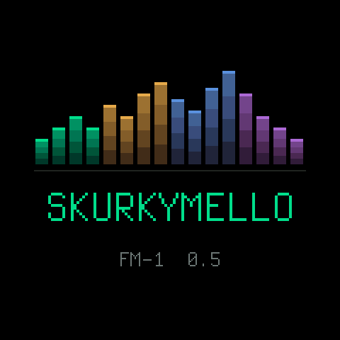</p>

> **Status: tested on emulators, not yet on an FM-1.** Every package runs in
> [fm1-emu](https://github.com/joakimeriksson/fm1-emu) and its web emulator; the first install on real hardware
> follows [docs/mello/FIRST_FLASH.md](docs/mello/FIRST_FLASH.md). Every flash can brick a unit: hold OCT- while
> switching on to reach the updater.

## At a glance

- **A melody at its heart.** Sixteen steps in four segments, a lead voice with filter, grit and a second oscillator,
  16 pattern slots (one a white key) and a loop cycle.
- **A band around it.** A bass with its own sequencer, a chord layer, a four-voice drum kit and a sample layer, with
  delay, reverb and distortion.
- **Movement.** DOT reads five 4 x 4 matrices along a route for accents, ratchets, the sub and two modulation lanes;
  EVOLVE, a Turing-machine register, mutates and bends the gate, the filter, the octave, the decay and two sound
  destinations as it plays.
- **Happy accidents.** RNDMZR rolls the lead, or the whole band in one of fifteen styles from AMBIENT to GLITCH, and
  UNDO takes it back.
- **Hands on.** PERFORM puts stutter, tape stop, repeats, filter sweeps and throws on the keys.
- **Connected.** MIDI in over USB and the TRS jack, MIDI clock in and out, the sound as a USB audio input, and the
  screen large on a computer ([Big screen](#big-screen)).

## What it is

The firmware is a port of [SkurkyMello](https://jhf.no/skurky/skurkymello.html), the browser instrument, to the
FM-1's keys, knobs and 240 x 240 screen; the HTML stays the reference for sound and feel. It is built on
[Dinghy](https://github.com/zvenson/dinghy) 0.5 by zvenson (its FM-1 platform) and, under that, the Felucca / SLOOP
platform.

This README is the manual. The design record is in [docs/mello/DECISIONS.md](docs/mello/DECISIONS.md), the plan in
[ROADMAP.md](ROADMAP.md), and every page's knobs and keys, generated from the code, in
[docs/mello/UI_MAP.md](docs/mello/UI_MAP.md).

## A word from me

This started as an HTML project where I tried to build my dream sequencer, inspired by the way I work on my modular
synth. After working on it for a few months it has since become the prototype I use most. The FM-1 version is my first attempt at porting an idea to actual
firmware, so please be kind.

This is a melody-focused firmware. The main sequencer is its heart. The chords and drums were only added for the FM-1
version, and I personally actually prefer using it without them.

Scope creep got the better of me, by the way, so there are a lot of menus on a very small screen. Sorry about that!

Anyway, enjoy.

*- Joakim*

## Install

From the browser: [the website](https://joakimskurk.github.io/fm1mello/) installs the latest build of `main`
over USB MIDI (Chrome or Edge on a computer), and has a take of the firmware playing, rendered by its own code.

Packages are `build/skurkymello-<version>.fwsc`. Install one on an FM-1 running M-VAVE's official V15 (or another
firmware with the FM-1 update loader), over USB-MIDI:

```sh
pip3 install mido python-rtmidi
python3 tools/fm1_install.py build/skurkymello-0.5-f99.fwsc
python3 tools/fm1_install.py --info        # what the FM-1 runs now
```

The same package plays in the web emulator (`joakimeriksson.github.io/fm1-emu`) and in `fm1-emu` on a computer. The
splash shows the version at boot.

## A first tour

Ten screens, drawn by the firmware itself (`make screens`): what you see, and what to do.

| | |
|---|---|
| 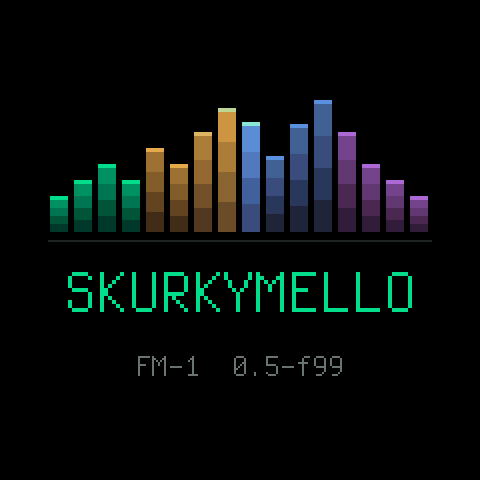 | **Switch on.** The splash shows the version while the project loads from flash, its sixteen steps playing once over. Then HOME. |
| 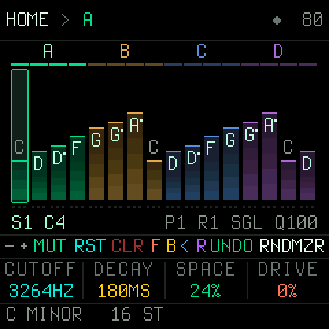 | **HOME.** Sixteen steps as bars: the height is the pitch, the note is written on the bar, the segments A-D sit over them in their colours. Under them the four macros on K1-K4, and at the bottom, over the keys, what the black keys do here. The header reads the key sounding and the length. |
| 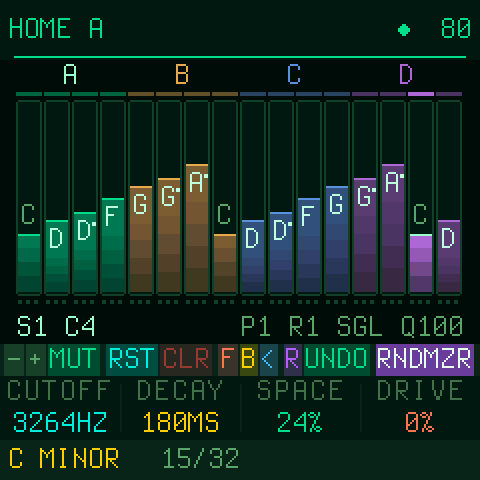 | **PLAY.** The playing step is bright, the LED blinks on the beat and the header counts the beats to the RESET (`21/32`: the 21st sixteenth of the two bars; with RESET on FREE, the step of the sequence). SELECT is the tempo (shown as you turn it), PRESETS the pattern slot. |
| 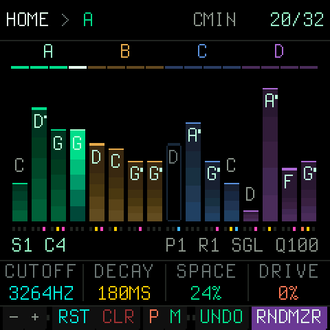 | **RNDMZR**, the black key before PERF. A tap rolls the lead by the randomizer's intensity (ALGORITHM: LOW, MED and HIGH raw, for happy accidents); with MUSICAL or GROOVE it rolls the whole band in a style (STYLE on the RANDOM page; ANY, a new one each time). Playing, the roll lands on the next bar's one (RNDMZR lit until then); UNDO, the key before it, takes the roll back (and again puts it forward). **Hold CLR** a second for INIT, a clean slate: the sequence empty, the bass, chords and drums off, the sound and the effects as new (the tempo, the key and the slots kept; UNDO takes it back). |
| 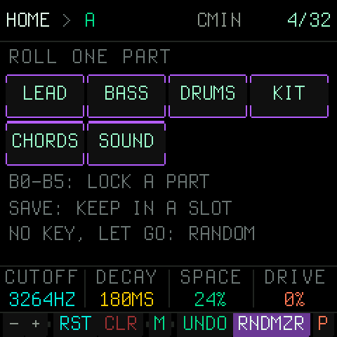 | **Hold RNDMZR** and a white key rolls one part again, in the style that plays: 1 LEAD, 2 BASS (the line and its sound), 3 DRUMS (the beat), 4 KIT (the drums' sound), 5 CHORDS, 6 SOUND (the lead's colour, the delay, the reverb). B0-B5 lock the same parts (a locked part is never rolled), SAVE keeps the band in the first free slot. Held half a second and let go with no key: the RANDOM page. **Hold UNDO** and white keys 1-3 bring back the band as it was before each of the last three rolls (the tempo kept); UNDO again goes back to where you were. |
| 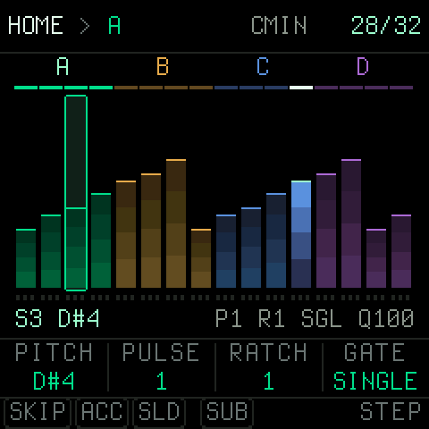 | **Hold a white key.** That step's pitch, pulses, ratchet and gate come onto K1-K4, its flags (SKIP, ACC, SLD, SUB) onto the first black keys. A tap mutes or unmutes the step. |
| 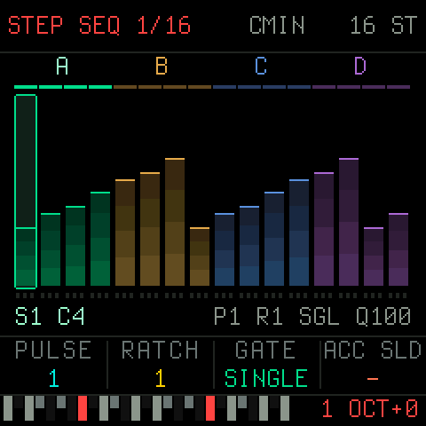 | **Tap REC.** The keys are a keyboard, lit where the scale has a tone, recording the sequence; REC again goes on to the bass line, the chords, the drums, then off. Stopped, each key is the next step; playing, the step under the clock. **Hold REC**: white keys 1-4 pick SEQ, BASS, CHORD, DRUMS, B0 the click (and a bar's count-in when PLAY starts a take); let go after half a second with neither and the take starts from empty. A take ends locked against RNDMZR, and a new bass gets its chords fitted. |
| 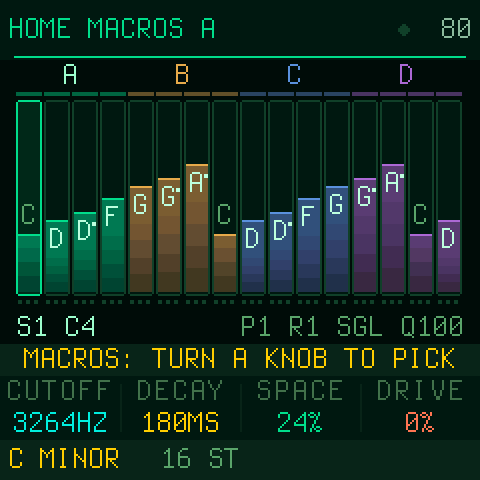 | **Hold EDIT.** MACROS: now each knob picks what it turns, from the performance parameters (RES, ATTACK, RELEASE, DELAY, REVERB, LFO, NOISE, the levels, SWING and more). Tap EDIT to leave; the choice is saved with the project. |
| 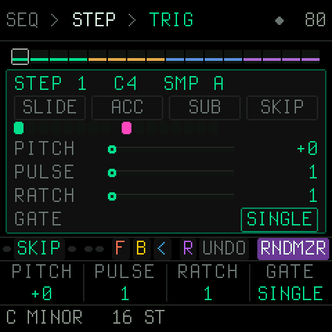 STEP"> | **SEQ.** The STEP page: the picked step's values, the picture drawn from them. SELECT turns the layers (TRIG, NOTE, FLAGS, SEQ); SEQ again goes on to SEGMENT, LOOP CYCLE and SLOT SEQ. With EDIT on, a white key sets the step's pitch. |
| 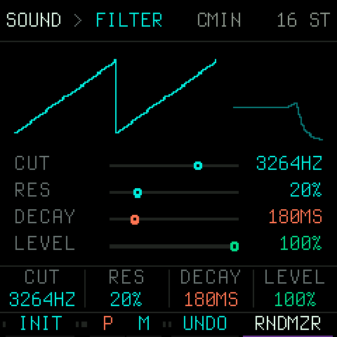 SOUND"> | **ENV.** The lead's sound: cutoff, resonance, decay and level first (K1-K4 so on every voice), the wave and PWM on OSC, the envelope, follower, grit, second oscillator and the rest on SELECT. INIT (B1) puts the sound back. ENV again: the sample layer. |
| 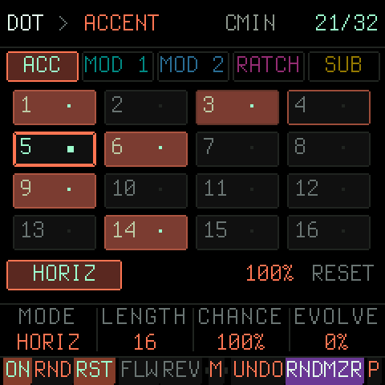 DOT, playing"> | **LFO**, twice: DOT. Five matrices (ACC, MOD 1, MOD 2, RATCH, SUB) as pills, a white key puts a cell on or off. Playing, the cell being read is framed bright with a fading trail behind it, so the route's direction shows; the cells on glow in the matrix's colour. ON (B0) switches the picked matrix. |
| 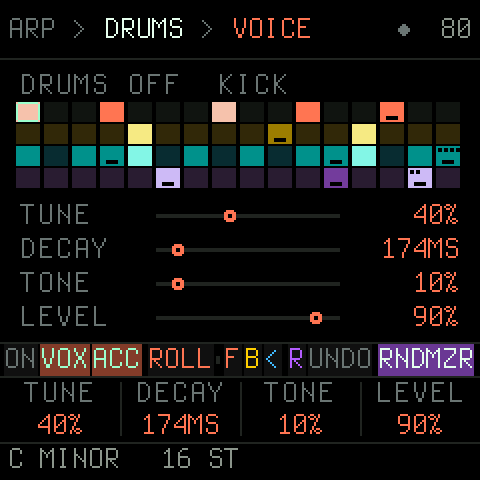 DRUMS"> | **ARP**, twice: the drums. Four voices on a 16-step grid; VOX picks the voice, a white key puts its hit on or off, ON (B0) turns the kit on. BASS is ARP's page before it, CHORD the one after. |
| 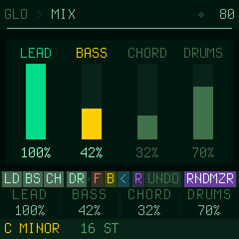 MIX"> | **GLO.** The mix: lead, bass, chords and drums on the knobs, a mute under each (LD, BS, CH, DR). SAVE writes the project to flash. |

Every page and layer is pictured beside its row in [docs/mello/UI_MAP.md](docs/mello/UI_MAP.md).

## The panel

The FM-1's panel is printed, so its names are the firmware's names. What each control is, everywhere:

| Control | What it is |
|---|---|
| **HOME** | The sequence, the four sound macros, the performance keys. From anywhere. |
| **SEQ, ENV, LFO, FX, ARP, SEL, GLO** | The sections. A press opens the section's first page; a press on the section you are in goes to its next page. Held (all but SEL), the section's pages on the white keys: a key goes there. |
| **ALGORITHM** (encoder) | The page within the section. |
| **SELECT** (encoder) | The layer within the page. The picked step or cell never moves with it. |
| **K1-K4** | The four values of the layer, always musical, never navigation. The screen's footer names them. |
| **PRESETS** (encoder) | On HOME: the pattern slot (it switches on the next bar). |
| **White keys** | Positions: steps, cells, bits, slots, chords. A tap toggles what sits on the key and picks it. |
| **Black keys** | The action rail, with fixed places (below). |
| **OCT- / OCT+** | The step bank where there are more than 16 (HOME, STEP, DRUMS), the octave in KEYS. |
| **PLAY** | Start and stop. The LED blinks on the beat. |
| **SAVE** | Saves the project (a save that cannot be made says NOSAVE or FULL in red in the header). Held: the pattern slots. |
| **EDIT** | The page's mode: KEYS on HOME (the keys become a keyboard, lit where the scale has a tone), the pitch mode on STEP. Held on HOME: MACROS, where each of K1-K4 picks what it turns. |
| **REC** | A tap: record (on HOME the sequence, straight into KEYS; again: BASS, CHORD, DRUMS, off; on STEP, BASS, CHORD, DRUMS that page's part). Held: white keys 1-4 the target, B0 the click; held half a second and let go: from empty. Stopped, each key writes the next step; playing, the step under the clock. SEL writes a rest. |
| **MASTER** (the knob) | The output level, in hardware. |

The screen, top to bottom: one line saying where you are as `PAGE > LAYER` (`DRUMS > KIT`; the layer alone where
both do not fit, the lit panel button saying the rest), the key sounding in short (`C#DOR`) and the beat (of the beats
before RESET; the step when RESET is FREE); the page's picture; K1-K4; and at the bottom, over the keys, what the black
keys do. A knob turned shows its name, value and range large over K1-K4 and the strip for a moment, so the picture it
changes stays in view. The project autosaves when the sequencer stops; NOSAVE (the flash holds a newer firmware's
project) or FULL (the project does not fit) appear in red in the header.

### The black keys, the same on every page

| Key | On every page | |
|---|---|---|
| B0 | **ON** for the page's part, where there is one (BASS, CHORD, DRUMS, SAMPLE, EVOLVE, LOOP CYCLE, SLOT SEQ, and on DOT the picked matrix) | |
| B1-B4 | The page's own keys, in the order pick, toggles, actions (HOME: transpose `-` `+`, RESTART, CLEAR: tapped twice the sequence's steps to rests, held a second INIT, a clean slate) | |
| B5 | free for the pages | |
| B6 | **MUT**ATE (M where the strip is full): the sequence mutated, as RNDMZR's mask allows | |
| B7 | free for the pages | |
| B8 | **UNDO**: the last roll or edit back (again: redo) | |
| B9 | **RNDMZR**: a roll of the randomizer; held: the RANDOM page | |
| B10 | **PERF** (P where the strip is full), the last black key: tapped, the PERFORM page until PERF or a page button; held, while held | performance |

The keys' lights say the same on every page: lit is what is happening now or on (the playhead, the step in focus,
a switch that is on), a glow is what is set or there (a step that plays, a scale tone, a black key with a function),
dark is nothing.

PERFORM's white keys are performance only, in a 4 x 4 on the screen, a row each (keys 1-4 the top row): the
sequence (FILL, ARP, REVERSE, ACCENT), its repeats (REP 8, REP 4, REP 2, REP 1), the sound (LP SWP, HP SWP, THROW,
WASH) and the parts' mutes (LD OFF, BS OFF, CH OFF, DR OFF). All act while held but the mutes, and keep time: every
part's place (the sequence, the drums, the bass line, the chord chain) moves on underneath, so letting go lands
where it would have been. FILL rolls the snare (a roll that builds: rising a semitone a step and louder, twice as
fast from the second bar held), plays every step of the bass line and strikes the chords on every
step; ARP plays the lead's note as an arpeggio, root, third, fifth, octave; REVERSE and REPEAT replay the drums, the
bass line and the chords' figures with the lead; ACCENT accents every note and hit. LP SWP and HP SWP sweep a filter
over the whole mix (closed in 1.5 s, open again a quarter of a second after); THROW sends everything into the delay
with its feedback up, WASH into the reverb, and their tails ring on when let go. LP SWP and HP SWP held together are a band
gliding down. The MUTEs latch (MIX's): stopped,
at once; playing, on the next beat (framed bright until then; a second tap takes it back). Never saved or undone.

PERFORM's black keys B0-B7 (along the top of the page) are eight more effects, held, together as you like (three letters on
the strip, the whole name while held): STU, STUTTER (the last bit of sound again and again), TPE, TAPE STOP (let go,
it is back at once), PLK, PLUCK (everything plucked short), CRS, CRUSH (bits and rate down), CHP, CHOP (the mix cut
on and off in time), OC- and OC+, OCT DOWN and UP (the notes an octave down or up), WRP, WARP (the pitch wavering, a
worn tape). While one is held, K1 turns its amount (STUT's 1/32 .. 1/4, TAPE's
150-1050 ms, PLUCK's length, CRUSH's depth, CHOP's 1/8 .. 1/32, one or two octaves, WARP's depth), the strip saying
it; the amount is kept for the next time. UNDO, RNDMZR and PERF stay where they are.

### The white keys, page by page

| Page | A white key |
|---|---|
| HOME | Tap: the step on or off. Hold: the step's pitch, pulses, ratchet and gate on K1-K4, its flags on the first four black keys. In KEYS: a keyboard; tap transposes the sequence, stopped it plays the lead. |
| STEP | Picks the step (a tap toggles it too); with EDIT on, a key sets its pitch. With REC on: a keyboard writing the sequence. |
| SEGMENT | Cuts or joins a segment at that step; SEL held: picks the segment. |
| LOOP CYCLE | Picks a loop position (the first eight keys); with the cycle off, auditions it. |
| SLOT SEQ, SLOTS, SAMPLE | Picks a position, a slot. |
| RANDOM | A target on or off (MASK), follows or mirrors the pitch (LINKS), picks the target (AMOUNTS). |
| KEY | The root. |
| DOT | A cell on or off. |
| EVOLVE | Flips a bit and picks it. |
| BASS | A BASS SEQ step on or off, and picks it (B1 SEQ turns BASS SEQ itself on or off). With REC on: a keyboard writing the bass line. |
| CHORD | Picks a chord of the chain (or a pattern step). With REC on: a keyboard writing the chain (a second key held: the chord's shape). |
| DRUMS | The picked voice's hit on or off at that step, and picks the step. With REC on: keys 1-4 KICK, SNARE, HAT, GLITCH (a key held with another, the same step), 5-8 the last hit's ACCENT, RATCH, PITCH down and up. |

**REC where you are.** On STEP, BASS, CHORD and DRUMS the REC button records that page's part, from its picked step:
stopped, each key writes the next step (SEL a rest); playing, the step under the clock, or the next once more than
half a pulse has gone, and a key that lands on the step already sounding is heard at once. Each key sounds in the
part's own voice. REC again, another page or PLAY's stop ends the take; one UNDO takes it back. On HOME a tap of REC
does the same for the sequence (no EDIT first), REC cycling on to the bass, the chords and the drums.

**Your own over the generated.** A take that wrote something ends locked against RNDMZR (LOCK on RNDMZR's parts,
unlocked with RNDMZR held and B0-B5), so you can roll the band around your idea; a bass take (or a lead take with no
bass) gets the chords fitted to it, inside the take's one UNDO. Hold REC half a second and let go to start the take
from empty: the part's steps go to rests (the bass line off, the chords off until a key writes one, the drums'
hits gone, their sound kept). With the click on (B0 while REC is held; on by default), PLAY starting a take counts in
a bar, and the take clicks on every beat while the drums are silent.

## HOME

Sixteen steps as bars (height = pitch, dim = off, the playing one bright), the segments A-D over them in their
colours. K1-K4 are the four macros, live while playing: CUTOFF, DECAY, SPACE (delay and reverb send) and DRIVE to
begin with. Hold EDIT for MACROS and turn a knob to give it another parameter (RES, ATTACK, RELEASE, DELAY, FDBK,
REVERB, SIZE, LFO HZ and LFO AMT, PWM, NOISE, DETUNE, OSC 2, FM, SAT, MODENV, SUB LVL, the LEAD, BASS, CHORD and
DRUMS levels, SWING); a tap of EDIT leaves, and the choice is saved with the project. Nothing on the list is a black
key's or an encoder's job.
SELECT is the tempo, ALGORITHM the randomizer's intensity (LOW, MED, HIGH, MUSICAL, GROOVE), PRESETS the pattern slot.
Hold a white key to edit that step on the knobs; tap it to mute or unmute it. RNDMZR rolls what the RANDOM page's
mask says (by default the first nine targets); UNDO takes it back.

**KEYS and REC.** Tap EDIT and the 27 keys are a keyboard, F3 to G5, OCT-/OCT+ moving it. The keys of the project's
scale are lit and the others dark, on the LEDs and in the strip; a dark key still plays, rounded to the nearest lit
one (CHROMATIC lights them all). Playing, a key is the new root. REC then cycles what the keys write: SEQ, BASS,
CHORD, off. Stopped, each key writes the next step from step 1 (a chord chain grows as you play it; hold a second
key over the first for the shape: a second SUS2, a fourth SUS4, a fifth POWER, a seventh SEVENTH; under the first for
the inversion: the third, the fifth). SEL writes a rest.

**Step entry** (REC on HOME with the sequencer stopped; the header reads `STEP SEQ 3/16`). The keys are a keyboard:
each key writes its note at the cursor (the step framed) and the cursor moves on; SELECT moves the cursor back or
on, to put a note right. K1-K4 are the step's, not the macros: with the key just played still held, that step's;
with none held, what the next steps get, and what you set stays for the steps after (set PULSE 2 and every note
from there lasts two pulses until you change it). SEQ: PULSE (how many pulses the step lasts), RATCH, GATE (SINGLE,
MULTI, HOLD), ACC SLD. BASS: GLIDE, ACCENT, and OCT for the key held. CHORD: HOLD (2, 4, 8, 16, 32 sixteenths),
SHAPE, and INV and OCT for the chord held. DRUMS: the last hit's PITCH, DECAY, CRUSH, RATCH. Playing, K1-K4 are the
macros again and SELECT the tempo.
Playing, a key writes the step under the clock, or the next one past half a pulse, and a key kept down carries on
over the next steps, so a line goes down pass by pass. UNDO takes the whole recording back.

## The sections

Each section is a button. Press it again (or turn ALGORITHM) for its next page; SELECT turns the page's layers.

| Button | Pages | Layers |
|---|---|---|
| **SEQ** | STEP · SEGMENT · LOOP CYCLE · SLOT SEQ | STEP: TRIG, NOTE, FLAGS, SEQ · LOOP CYCLE: STEP, HARM, LOOP |
| **ENV** | SOUND · SAMPLE | SOUND: FILTER, OSC, OSC 2, CHARACTER, GRIT, MOD ENV, TRACKING, AMP ENV, FOLLOWER, LFO · SAMPLE: MAIN, PITCH, TRIM, ENVELOPE |
| **LFO** | LFO · DOT · EVOLVE | DOT: the five matrices ACCENT, MOD 1, MOD 2, RATCHET, SUB · EVOLVE: MAIN, ROUTES, DEPTH, SOUND |
| **FX** | DISTORTION · DELAY · REVERB | DELAY: SEND, CONFIG · REVERB: ROOM, RETURNS |
| **ARP** | BASS · DRUMS · CHORD | BASS: PLAY, SEQ, STEP, VOICE, TONE, FILTER · DRUMS: VOICE, STEP, VARY, KIT, DIST · CHORD: PLAY, CHORD, VOICING, GRID, PATTERN, TONE, FILTER, MOTION, AMP |
| **SEL** | KEY / SCALE | |
| **GLO** | MIX · GLOBAL | GLOBAL: CLOCK, MIDI, GROOVE |
| hold **SAVE** | SLOTS | LOAD, RENAME |
| hold **RNDMZR** | RANDOM | MASK, LINKS, AMOUNTS |

Every page has one body: the part's picture on top, drawn from its values, and the four knobs as rows under it.
Levels and amounts read in %, times in ms (or s), cutoffs in Hz, pitch in semitones.

### What the parts do

- **The sequence** (SEQ > STEP). 16 steps (up to 32), each with a pitch in the key, pulses (its length), ratchets,
  a gate (SINGLE, HOLD, REST, MULTI), an octave, a chance, a sample slot and its own wave; flags for accent, sub,
  slide and skip. SEQ's last layer sets the length, the bar reset, the clock division and the pitch span. At the
  reset (RESET 1 to 8 BAR) every part starts over together: the sequence, the drums, the bass line and the chord
  chain; FREE leaves each on its own clock.
- **Segments** (SEQ > SEGMENT). The sequence cut into up to six segments A-F, each with repeats, an order (FWD, REV,
  ping-pong, random) and a skip; EVEN spreads the cuts.
- **Loop cycle** (SEQ > LOOP CYCLE). Up to eight steps, each held for a number of pulses: a chord progression over
  the loop. ROOT+ moves the key itself; TRANS (the lead and chords) and BASS TR (the bass) move by semitones and
  land on the key's nearest tone in that direction, so nothing leaves the key (in C minor, C +1 is D); KEY and
  SCALE change the key where they are not FOLLOW. The header, KEYS and the lights show the key sounding.
  CHROMATIC transposes by plain semitones.
- **Slot sequence** (SEQ > SLOT SEQ). Pattern slots played in a row, each held for a number of pulses.
- **The lead** (ENV > SOUND). Saw, square, triangle, sine or pulse through a 24 dB filter (LP, HP, BP, NOTCH), an ADSR,
  an LFO (filter, pitch, PWM, amp, and the drums), a follower sub an octave or two under it, grit (noise, noise
  FM, unison with detune), a second oscillator with sync and FM, saturation, a MOD envelope, velocity and key
  tracking. INIT (B1) puts the sound back.
- **The sample layer** (ENV > SAMPLE). Four slots of user samples, per step or fixed, with pitch, trim, loop and an
  envelope. Samples come in from the computer over USB-MIDI with `tools/fm1_samples.py` (below).
- **DOT** (LFO > DOT). Five 4 x 4 matrices read along a route (horizontal, spiral, random, walk ...) at the
  sequence's pace: accents, ratchets, the sub, and two MOD lanes that shape a sound parameter with an attack and a
  release.
- **EVOLVE** (LFO > EVOLVE). A Turing-machine register that mutates by a probability, routed to the gate (LENGTH
  shortens notes, on by default; RETRIG re-attacks on every pulse, off), filter, octave and decay, and to two sound
  destinations: the lead's (cutoff, resonance, decay, pitch, OSC 2, FM, noise,
  saturation, detune, PWM), the drums' (tune, decay, crush, drive) or the chords' (C.CUT, C.LEVEL). A negative
  depth inverts, so the chords can open while the lead closes. DOT's MOD lanes reach the same destinations.
- **FX**. Distortion with a character and a tone (PRE-DIST puts the delay before it), a delay synced to the tempo
  (32N to 1 BAR, triplets and dotted; past 1.49 s the line runs at half rate and reaches 2.97 s, a division past
  even that shows a "~" and plays the longest it can) or free, with feedback and LO CUT (120 Hz on a new project);
  PING (B2) sends the echoes left and right in turn (it reads the line at twice the time, so its reach is half)
  and HI CUT on its echoes, and a reverb with size, decay, pre-delay and tone. TRIM (REVERB RETURNS, K4) sets
  the whole output by -6..+6 dB; a STYLE roll sets it so every style plays at about the same level.
- **Chords** (ARP > CHORD). A chain of up to eight chords in the key (degree, shape, inversion, spread, octave);
  a new project starts on one, the tonic. B3 FIT makes the chain from what plays: a chord every half bar on the
  bass line's note there (the lead's with the bass off), so the bass is always in the chord; pressed again over the
  same bass, sevenths, then colour (sus), then the chord whose third the bass note is, then the triads again.
  The chain is sounded one of two ways, B2 POLY picking it per project. SUB MELLO (a new project's) is one voice that plays the
  chord's tones one at a time: BROKEN (low, high, middle, high, the default), WALK (the chord's tones on the beats,
  the scale's steps between), arpeggios up, down or both ways, a pattern, STAB (the top tone) or HOLD (the top tone
  held), the delay making the line a chord. POLY is four voices with a Juno-like chorus and STRUM, the chords
  stabbed, held, arpeggiated or by a pattern of voice masks. Both: triggered by the steps or by a grid; voice
  leading; a resonant filter with its envelope, an ADSR; their sends on MIX. B1 BASS
  puts the bass on the chord's root (CHD on the BASS page is the same switch). The HARMONY layer ties the chords to the rest: FOLLOW moves the lead's notes
  on the beats (or all of them) to the chord sounding, and DRIFT lets one chord change each time the chain comes
  round, within DEPTH (a degree of the same function, the shape, the voicing, or any), the first chord keeping
  its degree, so a long piece evolves and still comes home. RNDMZR at MED, HIGH and MUSICAL rolls a progression
  on the clock chain, so the chords change on the grid and land on the one.
- **Bass** (ARP > BASS). The dedicated sub voice, two octaves under the key's root at its default OCT -1 (C2,
  65 Hz, in C): a step, euclidean, matrix, register or drone mode, or BASS SEQ, a
  16-step bass line of its own with tone, octave, glide and accent per step (CLOCK: its OWN steps, or one at each of
  the LEAD's), a resonant filter with envelope, drive. The page's title says what plays the bass ("BASS  SEQ 16",
  "BASS  EUCLID 6") and, with CHD (B3) lit, the chord it stands on now ("ON Fm7"): CHD moves the line with the
  chords' root, the nearest way. ROLL (B2) writes a line under the sequence as it is: roots and fifths, or the lead's chord tones, on the beats,
  walks and octave jumps between, an octave down; UNDO takes it back.
- **Drums** (ARP > DRUMS). Kick, snare, hat and a glitch voice (bleep, chirp, crackle, stutter) on a pattern of
  up to 32 steps (OCT- and OCT+ show 1-16 and 17-32; a line made longer than 16 copies its bar there) with accents, per-step pitch, decay, crush and ratchet locks, rolls, chance, swing (GLOBAL > GROOVE, for
  everything), a length and a direction per voice (LINE: V.LEN, KICK 16, SNARE 16, HAT 12, GLITCH 7 is a polyrhythm;
  DIR forward, backwards or there and back; RESTART: BAR starts them all over at every bar's one, FREE lets them
  run until RESET, start or stop), swing per part (GLOBAL > GROOVE: LEAD, BASS, DRUMS their own, or GLOBAL), a kit drive with fold, DUCK (the kick's sidechain: the lead, sub and chords dip at each kick and
  come back over 160 ms), and their sends on MIX. RNDMZR rolls them too with FEED on. The kick is built
  for weight: a driven sine from 38 to 90 Hz whose pitch falls from 3.5x over 90 ms, decaying up to 1.5 s.
- **MIX** (GLO > MIX). The levels of lead, bass, chords and drums as faders, each with a mute (LD, BS, CH, DR; the
  bass goes to 200%, and each style sets the bass's and the chords' level as it rolls, so the band sits together);
  SELECT turns to each part's send to the delay (DELAY) and to the reverb (REVERB), the effects' WET on the FX
  pages scaling them all. The lead and its samples go through the lead's filter and distortion; the bass, the
  chords and the drums do not.
- **GLOBAL** (GLO > GLOBAL). Tempo (TAP), division, external sync, note out; the MIDI channels of lead and bass,
  the note length; the groove's swing. CLOCK shows the chip's measured audio load as CPU nn%.
- **KEY** (SEL). Root, scale, global octave, pitch span.
- **RANDOM** (hold RNDMZR). Which targets a roll touches (MASK), which follow or mirror the pitch (LINKS), how much
  each moves (AMOUNTS); the intensity on K1. MUSICAL rolls a phrase, not noise; GROOVE the same phrase with rolls, ties, ghost
  notes and the rests that answer them. STYLE on K2: ANY (a new project's: a new style each time, never the one before) or a
  style; a tap of RNDMZR with INT on MUSICAL or GROOVE rolls the whole band in it (on LOW, MED, HIGH the lead alone, raw, as before the styles), the lead within the mask, the bass line, the beat, the
  chords and some of the sound (never the tempo: that is the player's, and UNDO leaves it too): AMBIENT, DUB, TRIPHOP, TECHNO, ACID, ELECTRO, BREAKS, IDM, HOUSE, DEEP,
  MINIMAL, JUNGLE, DRONE, OUTRUN, GLITCH, its name shown
  as it lands. ROLLS on K3: ALL, or PLAYING, which leaves the parts that are off off (the drums, the chords,
  the bass), for playing it as a melody instrument. Playing, every roll of RNDMZR waits for the next bar's one;
  UNDO before then takes it back. UNDO takes a roll back whole.

## Every page's knobs and keys

Generated from the code (`docs/mello/UI_MAP.md`, where every row also has its page's picture): the strip is what the black keys B0..B10 read on that page, then
K1-K4 with their default values.

| Page | Button | Layer | Strip B0..B10 | K1 · K2 · K3 · K4 |
|---|---|---|---|---|
| HOME | HOME | — | `- + RST CLR M UNDO RNDMZR P` | CUTOFF 3264HZ · DECAY 180MS · SPACE 24% · DRIVE 0% |
| HOME | hold EDIT | MACROS | `- + RST CLR M UNDO RNDMZR P` | each knob picks what it turns (CUTOFF, RES, DECAY, ATTACK, RELEASE, SPACE, DRIVE, DELAY, FDBK, REVERB, SIZE, LFO HZ, LFO AMT, PWM, NOISE, DETUNE, OSC 2, FM, SAT, MODENV, SUB LVL, LEAD, BASS, CHORD, DRUMS, SWING) |
| STEP | SEQ | TRIG | `SKIP MUT UNDO RNDMZR PERF` | PITCH +0 · PULSE 1 · RATCH 1 · GATE SINGLE |
| STEP | SEQ | NOTE | `SKIP MUT UNDO RNDMZR PERF` | OCT +0 · PROB 100% · SAMP 1 · WAVE SND |
| STEP | SEQ | FLAGS | `SKIP MUT UNDO RNDMZR PERF` | ACCENT OFF · SUB OFF · SLIDE OFF · SKIP OFF |
| STEP | SEQ | SEQ | `SKIP MUT UNDO RNDMZR PERF` | LENGTH 16 · RESET 2 BAR · DIV 1 · SPAN 2 |
| SEGMENT | SEQ | SEGMENT | `EVEN A B C D M UNDO RNDMZR P` | REPEAT 1 · ORDER FWD · SKIP OFF · LENGTH 4 |
| SEGMENT | SEQ | (2) | `EVEN A B C D M UNDO RNDMZR P` | REPEAT 1 · ORDER FWD · SKIP OFF · LENGTH 4 |
| LOOP CYCLE | SEQ | STEP | `ON RST MUT UNDO RNDMZR PERF` | HOLD 16 · ROOT+ +0 · OCT +0 · TRANS +0 |
| LOOP CYCLE | SEQ | HARM | `ON RST MUT UNDO RNDMZR PERF` | KEY FOLLOW · SCALE FOLLOW · SUB 0 · BASS TR +0 |
| LOOP CYCLE | SEQ | LOOP | `ON RST MUT UNDO RNDMZR PERF` | LENGTH 4 · SYNC SYNC · ON OFF · — |
| SLOT SEQ | SEQ | — | `ON MUT UNDO RNDMZR PERF` | SLOT OFF · HOLD 16 · ON OFF · LENGTH 16 |
| RANDOM | hold RNDMZR | MASK | `NONE ALL CLR MUT UNDO RNDMZR PERF` | INTENS MED · STYLE ANY · ROLLS ALL · — |
| RANDOM | hold RNDMZR | LINKS | `NONE ALL CLR MUT UNDO RNDMZR PERF` | INTENS MED · STYLE ANY · ROLLS ALL · — |
| RANDOM | hold RNDMZR | AMOUNTS | `NONE ALL CLR MUT UNDO RNDMZR PERF` | AMOUNT PIT 10~ · — · — · — |
| KEY / SCALE | SEL | — | `MUT UNDO RNDMZR PERF` | ROOT C4 · SCALE minor · OCT +0 · SPAN 2 |
| SLOTS | hold SAVE | LOAD | `MUT UNDO RNDMZR PERF` | — · VISIBLE 8 · — · — |
| SLOTS | hold SAVE | RENAME | `MUT UNDO RNDMZR PERF` | CURSOR 1 · CHAR - · — · — |
| DOT MATRIX | LFO | ACCENT | `ON RND RST FLW REV M UNDO RNDMZR P` | MODE HORIZ · LENGTH 16 · CHANCE 100% · EVOLVE 0% |
| DOT MATRIX | LFO | MOD 1 | `ON RND RST FLW REV M UNDO RNDMZR P` | MODE HORIZ · LENGTH 16 · DEPTH 24% · EVOLVE 0% |
| DOT MATRIX | LFO | MOD 2 | `ON RND RST FLW REV M UNDO RNDMZR P` | MODE HORIZ · LENGTH 16 · CHANCE 100% · EVOLVE 0% |
| DOT MATRIX | LFO | RATCHET | `ON RND RST FLW REV M UNDO RNDMZR P` | MODE HORIZ · LENGTH 16 · CHANCE 100% · EVOLVE 0% |
| DOT MATRIX | LFO | SUB | `ON RND RST FLW REV M UNDO RNDMZR P` | MODE HORIZ · LENGTH 16 · DEPTH 24% · EVOLVE 0% |
| EVOLVE | LFO | MAIN | `ON RND LOOP MUT UNDO RNDMZR PERF` | MUTATE 10% · LENGTH 8 · RATE 1X · OFFSET +0 |
| EVOLVE | LFO | ROUTES | `ON RND LOOP MUT UNDO RNDMZR PERF` | GATE LENGTH · FILTER OFF · OCT OFF · DECAY OFF |
| EVOLVE | LFO | DEPTH | `ON RND LOOP MUT UNDO RNDMZR PERF` | GATE 35% · FILTER 35% · OCT 35% · DECAY 35% |
| EVOLVE | LFO | SOUND | `ON RND LOOP MUT UNDO RNDMZR PERF` | DEST A OFF · DEPTH A +50% · DEST B OFF · DEPTH B +50% |
| BASS | ARP | PLAY | `ON SEQ ROLL CHD M UNDO RNDMZR P` | MODE STEP · PULSES 6 · ROTATE 0 · OCT -1 |
| BASS | ARP | SEQ | `ON SEQ ROLL CHD M UNDO RNDMZR P` | SEQ OFF · LENGTH 16 · CLOCK OWN · GATE 90% |
| BASS | ARP | STEP | `ON SEQ ROLL CHD M UNDO RNDMZR P` | TONE ROOT · OCT +0 · GLIDE OFF · ACCENT ON |
| BASS | ARP | FILTER | `ON SEQ ROLL CHD M UNDO RNDMZR P` | CUT 242.0HZ · RES 0% · ENV 0% · LEVEL 75% |
| BASS | ARP | VOICE | `ON SEQ ROLL CHD M UNDO RNDMZR P` | WAVE SINE · DECAY 160MS · RELEASE 120MS · DRIVE 0% |
| BASS | ARP | TONE | `ON SEQ ROLL CHD M UNDO RNDMZR P` | GLIDE 20MS · OCT -1 · F.DEC 300MS · ACCENT 50% |
| GLOBAL | GLO | CLOCK | `TAP RST2 MUT UNDO RNDMZR PERF` | BPM 80 · DIV 1 · SYNC OFF · NOTEOUT OFF |
| GLOBAL | GLO | MIDI | `TAP RST2 MUT UNDO RNDMZR PERF` | LEAD 1 · SUB 2 · NOTE STEP · LENGTH 180MS |
| GLOBAL | GLO | GROOVE | `TAP RST2 MUT UNDO RNDMZR PERF` | SWING 0% · LEAD GLOBAL · BASS GLOBAL · DRUMS GLOBAL |
| SOUND | ENV | FILTER | `INIT MUT UNDO RNDMZR PERF` | CUT 3264HZ · RES 20% · DECAY 180MS · LEVEL 100% |
| SOUND | ENV | OSC | `INIT MUT UNDO RNDMZR PERF` | WAVE SAW · PWM 50% · SLIDE 50MS · MASTER 75% |
| SOUND | ENV | AMP ENV | `INIT MUT UNDO RNDMZR PERF` | ATTACK 5MS · DECAY 180MS · SUSTAIN 40% · RELEASE 120MS |
| SOUND | ENV | LFO | `INIT MUT UNDO RNDMZR PERF` | LFO OFF · RATE 2.00HZ · DEPTH 35% · TARGET FILTER |
| SOUND | ENV | FOLLOWER | `INIT MUT UNDO RNDMZR PERF` | SUBOSC ON · LEVEL 22% · OCT -1 · WAVE SINE |
| SOUND | ENV | GRIT | `INIT MUT UNDO RNDMZR PERF` | NOISE 0% · N.FM 0% · UNISON 1 · DETUNE 0 CT |
| SOUND | ENV | OSC 2 | `INIT MUT UNDO RNDMZR PERF` | WAVE OFF · SEMI +0 ST · FINE +7 CT · MIX 0% |
| SOUND | ENV | CHARACTER | `INIT MUT UNDO RNDMZR PERF` | SYNC OFF · FM 0% · SAT 0% · FILTER LP |
| SOUND | ENV | MOD ENV | `INIT MUT UNDO RNDMZR PERF` | AMT +0% · ATTACK 0MS · DECAY 300MS · TARGET CUTOFF |
| SOUND | ENV | TRACKING | `INIT MUT UNDO RNDMZR PERF` | V.CUT +0% · V.LVL 100% · KEYTRK 0% · V.ENV +0% |
| AUDIO FX | FX | DISTORTION | `PRE-DIST PING M UNDO RNDMZR P` | AMT 0% · MIX 100% · CHAR 35% · TONE 82% |
| AUDIO FX | FX | DELAY SEND | `PRE-DIST PING M UNDO RNDMZR P` | WET 12% · FDBK 32% · LO CUT 120HZ · HI CUT 72% |
| AUDIO FX | FX | DELAY CONFIG | `PRE-DIST PING M UNDO RNDMZR P` | SYNC ON · DIV 8N · TIME 250MS · LEVEL 75% |
| AUDIO FX | FX | REVERB ROOM | `PRE-DIST PING M UNDO RNDMZR P` | WET 24% · SIZE 70% · DECAY 6.0S · TONE 62% |
| AUDIO FX | FX | REVERB RETURNS | `PRE-DIST PING M UNDO RNDMZR P` | PRE 12MS · LEVEL 115% · D.LEVEL 90% · TRIM 0 DB |
| SAMPLE | ENV | MAIN | `ON MUT UNDO RNDMZR PERF` | LEVEL 70% · DIST 0% · TRACK ON · LOOP OFF |
| SAMPLE | ENV | PITCH | `ON MUT UNDO RNDMZR PERF` | COARSE +0 · FINE +0 · LEVEL 70% · DIST 0% |
| SAMPLE | ENV | TRIM | `ON MUT UNDO RNDMZR PERF` | START 0% · END 100% · TRACK ON · LOOP OFF |
| SAMPLE | ENV | ENVELOPE | `ON MUT UNDO RNDMZR PERF` | ATTACK 5MS · DECAY 120MS · SUSTAIN 70% · RELEASE 150MS |
| DRUMS | ARP | VOICE | `ON VOX ACC ROLL M UNDO RNDMZR P` | TONE 25% · TUNE 40% · DECAY 335MS · LEVEL 90% |
| DRUMS | ARP | STEP | `ON VOX ACC ROLL M UNDO RNDMZR P` | PITCH +0 ST · DECAY +0% · CRUSH 0% · RATCH 1 |
| DRUMS | ARP | VARY | `ON VOX ACC ROLL M UNDO RNDMZR P` | CHANCE 100% · CRUSH 0% · FEED OFF · ROLL 50% |
| DRUMS | ARP | KIT | `ON VOX ACC ROLL M UNDO RNDMZR P` | LENGTH 16 · CLOCK OWN · — · LEVEL 95% |
| DRUMS | ARP | DIST | `ON VOX ACC ROLL M UNDO RNDMZR P` | DRIVE 0% · FOLD 0% · DUCK 0% · — |
| DRUMS | ARP | LINE | `ON VOX ACC ROLL M UNDO RNDMZR P` | V.LEN KIT · DIR FWD · RESTART FREE · — |
| CHORD | ARP | PLAY | `ON BASS POLY FIT M UNDO RNDMZR P` | MODE BROKEN · TRIG STEP · CHORDS 1 · GATE 72% |
| CHORD | ARP | CHORD | `ON BASS POLY FIT M UNDO RNDMZR P` | DEG 1 · SHAPE TRIAD · HOLD 8 · OCT -1 |
| CHORD | ARP | VOICING | `ON BASS POLY FIT M UNDO RNDMZR P` | INV 0 · SPREAD 1 · VOICES 3 · VLEAD OFF |
| CHORD | ARP | GRID | `ON BASS POLY FIT M UNDO RNDMZR P` | MODE HORIZ · LENGTH 16 · DEPTH 100% · FOLLOW OFF |
| CHORD | ARP | PATTERN | `ON BASS POLY FIT M UNDO RNDMZR P` | MASK 1 · LENGTH 8 · — · — |
| CHORD | ARP | FILTER | `ON BASS POLY FIT M UNDO RNDMZR P` | CUT 783.0HZ · RES 18% · ENV 22% · LEVEL 13% |
| CHORD | ARP | TONE | `ON BASS POLY FIT M UNDO RNDMZR P` | WAVE SAW · — · LINK OFF · — |
| CHORD | ARP | MOTION | `ON BASS POLY FIT M UNDO RNDMZR P` | F.ATK 8MS · F.DEC 700MS · — · NEXT STEPS |
| CHORD | ARP | AMP | `ON BASS POLY FIT M UNDO RNDMZR P` | ATTACK 40MS · DECAY 900MS · SUSTAIN 75% · RELEASE 900MS |
| CHORD | ARP | HARMONY | `ON BASS POLY FIT M UNDO RNDMZR P` | FOLLOW OFF · DRIFT 0% · DEPTH ALL · — |
| MIX | GLO | LEVEL | `LD BS CH DR MUT UNDO RNDMZR PERF` | LEAD 100% · BASS 75% · CHORD 13% · DRUMS 95% |
| MIX | GLO | DELAY | `LD BS CH DR MUT UNDO RNDMZR PERF` | LEAD 100% · BASS 0% · CHORD 60% · DRUMS 25% |
| MIX | GLO | REVERB | `LD BS CH DR MUT UNDO RNDMZR PERF` | LEAD 100% · BASS 20% · CHORD 60% · DRUMS 25% |

## Saving, slots and MIDI

The project (the sequence, every part, 16 slots and the slot sequence) lives in flash and is saved by SAVE, and on
its own after an edit once the sequencer stops; two banks with checksums, so a cut power never loses more than the
last edit. SAVE held opens the slots: LOAD a slot onto the sequence, RENAME it with the keys; PRESETS on HOME queues
a slot for the next bar. The 16 slots, all full, fit the bank three times over. A project saved with more (there were 64
until 0.5-f86) is read with its first 16.

SkurkyMello keeps its projects and samples in its own format and its own part of the flash. It cannot read another
firmware's projects or samples, and other firmwares cannot read its own: installing SkurkyMello over another firmware
starts from a new project (the other firmware's saves may be overwritten), and samples go on again with
`tools/fm1_samples.py`.

MIDI in comes over USB and over the FM-1's TRS jack (Dinghy 0.4's parser: channel messages, clock and transport;
SysEx only over USB); MIDI out goes over USB. With SYNC set to SLAVE (GLOBAL > CLOCK) the sequencer follows clock,
start, continue and stop from either input; notes in are not played (the sequencer is the player). Notes out go for
the lead and the bass on their channels (NOTE OUT), the chords on the lead's, and for the drums on channel 10 as General MIDI. In the emulators
MIDI arrives through the jack: fm1-emu's `--keys 'T:midi:903c64'` and the web emulator's MIDI in both feed UART1, so
from 0.5-f28 on SkurkyMello hears them.

### Samples

Four slots of 32 KiB in flash, each a mono sound at 22 050 Hz as IMA ADPCM, up to 2.87 s; the SAMPLE page shows a
slot's name, and a step or the whole layer plays it at any pitch. A WAV goes into a slot from the computer, over
USB-MIDI, while the sequencer is stopped:

```sh
python3 tools/fm1_samples.py send kick.wav --slot 0 --name KICK
python3 tools/fm1_samples.py send choir.wav --slot 1 --start 1.5 --length 2.5 --normalize
python3 tools/fm1_samples.py query --slot 1          # loaded or empty
python3 tools/fm1_samples.py clear --slot 1
```

The tool mixes to mono, resamples, encodes, and sends the slot's flash record as it will lie in flash; the FM-1
answers after START and END, and a transfer takes a second or two. The record goes to a staging area first, so a
cut transfer never damages what the slot had. A clear is taken only straight after a query of the same slot (the
tool sends both), so a controller's stray CC 113 on channel 16 cannot empty a slot. With the web emulator nothing comes back: add `--no-ack`, and pick
the MIDI port it listens to with `--port` (it takes the computer's MIDI inputs; on macOS an IAC bus does). For
fm1-emu on the command line, `emu-keys` prints the whole transfer as its `--keys` script:

```sh
python3 tools/fm1_samples.py emu-keys kick.wav --slot 0 > keys.txt
fm1-emu --fwsc skurkymello.fwsc --ms 8000 --keys "$(cat keys.txt)"
```

The protocol is plain channel messages on MIDI channel 16 (CC 110 to 114 and 120 / 121, poly aftertouch for the
data: `tools/fm1_samples.py --help`), not SysEx, so keep other gear off channel 16 while sending. `pack` writes the
record to a file and `decode` turns one back into a WAV.

Where the room is: the four slots are 0xC0000 to 0xDFFFF in flash with the 32 KiB staging area under them at
0xB8000, below that the two 64 KiB project banks. In RAM the slots' compressed data (4 x 32 KiB) live in the
336 KiB pool next to the delay and reverb lines (17 KiB of it is free); the audio callback decodes block by block.

### Big screen

The FM-1's screen, large, on a computer, tablet or phone: install [FM-1 Mirror](https://github.com/pfkellogg/fm1-mirror)
(free; Mac, Windows, Linux, Android), plug the FM-1 in over USB and open the app. SkurkyMello speaks its messages:
while the app asks (a short SysEx about once a second) the firmware sends every row it paints over the same USB MIDI
connection, in colour, and stops three seconds after the app goes quiet, so with nobody asking it sends nothing and
playing is unaffected. A new viewer gets the whole screen, zone by zone. Nothing to set up on
the FM-1. The protocol and the encoder are Patrick F. Kellogg's (MIT, `firmware/src/screen_mirror.c`); the glue is
`mirror.c`, and `make test` checks, on the host, that the screen rebuilt from the messages is the screen, pixel for
pixel.

## Work on it

```sh
make test          # the host tests (tests/mello, Dinghy's installer and loader screen): no FM-1, no toolchain
make sanitize      # the same with UBSan and ASan
make parity        # the C engine against the HTML's renders (needs numpy)
make bench         # where the audio's time goes on this computer
make host          # the whole firmware on this computer: a WAV and screen PNGs (pip3 install Pillow)
make screens       # every page as PNG in docs/screens, and the UI map's pictures (python3, nothing else)
make art           # the README's logo, the GIF at its top and the website's link preview (needs Pillow)
make site          # the website in build/site, as CI publishes it (PKG=, VER=; needs numpy, ffmpeg or afconvert)
make format        # clang-format the Mello sources (pip3 install clang-format)
make emu PKG=build/skurkymello-0.5-f60.fwsc   # a package on fm1-emu: played and edited live, its load, its stacks
```

One change, `make test`, `make format`, commit. The target build checks what the host cannot: RAM, the pools and the
package. Audio code keeps to the rules in CLAUDE.md: no flash, no unbounded loops, no 64-bit division in the audio
callback, fixed point in range.

### Build the firmware

Python 3 with Pillow, the JieLi toolchain and the AC79 SDK (as in Dinghy's README):

```sh
tools/get_toolchain.sh                      # JieLi's clang for the chip, to ~/.jieli/toolchain
git clone --depth 1 --branch AC79NN_SDK_V1.2.1_2023-12-13 \
    https://gitee.com/Jieli-Tech/fw-AC79_AIoT_SDK.git ~/fw-AC79_AIoT_SDK
./build.sh                                  # -> build/skurkymello-dev.fwsc
./build.sh --release 0.5-f27                # -> build/skurkymello-0.5-f27.fwsc
MELLO_CFLAGS=-DMELLO_STRESS ./build.sh --release 0.5-x1    # the worst case plays at boot, for measuring
```

The toolchain is Linux x86-64 only; on a Mac, `build.sh` runs it in a `linux/amd64` Docker container. GitHub Actions
builds every push the same way (`.github/workflows/build.yml`) and attests the package.

### Measure

`tools/emu_cpu.sh PACKAGE.fwsc` runs the package in fm1-emu, in silence and then playing, and reports the audio
interrupt's share of the chip in instructions per second (the emulator counts instructions, not cycles). The chip's
own cycles show on GLOBAL > CLOCK as CPU nn%. 0.5-f27: the default pattern 32%, the worst case (everything on at
once) 71%, silence 2%; 7.4 KB of RAM free, and the build fails under 2 KB. 0.5-f60: the default pattern 35.5%, 10.1
KB of RAM free. `tools/emu_smoke.sh` plays the package 10 s while it turns the knobs and goes through the pages, and
fails if the sound dies or the load passes 60%; `tools/emu_stack.sh` reads how deep the two stacks went (0.5-f59:
3.2 of 23.75 KB and 1.1 of 7.75 KB). `make emu PKG=...` runs both.

## Where things are

```
firmware/src/dinghy.c          the app: wires Mello to the FM-1 (audio callback, keys, screen, storage, the CPU load)
firmware/src/mello_engine.*    the project, its defaults, the generative sequencer, the drums' and chords' logic
firmware/src/mello_transport.* clock, steps, ratchets, gate, MIDI out
firmware/src/mello_audio.*     the synth, bass, chords, drums, samples, FX and reverb (fixed point)
firmware/src/mello_ui.*        pages, keys, pictures
firmware/src/mello_storage.*   projects in flash (A/B banks with CRC)
firmware/src/mello_sample.*    user samples
firmware/src/platform.c, hal/  Dinghy's platform, as close to upstream as possible
firmware/src/midi_uart.c       Dinghy's MIDI IN on the TRS jack, as upstream has it
firmware/loader/               the update loader, with its screen (ldr_screen.c), as Dinghy 0.5 has it
tests/mello/                   host tests;  tests/bench/  the CPU bench;  tests/parity/  the HTML parity
tools/fm1_samples.py (WAVs into the sample slots), fm1_install.py (Dinghy 0.5's), screens.py (the pages as PNG), emu_cpu.sh, emu_smoke.sh,
                               emu_stack.sh, build.py
reference/skurkymello.html     the original (it plays at jhf.no/skurky/skurkymello.html): the reference for sound and feel
web/                           the website: its page, its installer (SLOOP's), its demos (make_site.py)
docs/mello/                    DECISIONS.md, UI_MAP.md, CONTROL_GRAMMAR.md, UI_ICEBERG.md, FIRST_FLASH.md
docs/screens/                  every page of the firmware as a picture, drawn by the host build (make screens)
```

## Support

SkurkyMello is free. If it gives you music, you can [buy me a coffee](https://buymeacoffee.com/skurk).

<a href="https://buymeacoffee.com/skurk"></a>

## Credits

SkurkyMello stands on other people's work. Thank you all:

- **[Dinghy](https://github.com/zvenson/dinghy)** by zvenson: the app framework, the host mode, the TRS MIDI IN, the
  installer's updates and the update loader's screen (from OberVave and from Skiff by illuminus5).
- **[Felucca](https://github.com/hugelton/Felucca)** by Leo Kuroshita (@kurogedelic), Hügelton Instruments: the
  platform under Dinghy (HAL, loader, USB, the build tools).
- **[SLOOP](https://github.com/isod89/sloop-fm1)** by isod89: its changes to that platform.
- **[FM-1 Mirror](https://github.com/pfkellogg/fm1-mirror)** by Patrick F. Kellogg: the Big screen protocol and its
  encoder (MIT).
- **[fm1-emu](https://github.com/joakimeriksson/fm1-emu)** by Joakim Eriksson: the emulator every package is tested in.
- **Terminus** by Dimitar Toshkov Zhekov: the screen font (SIL OFL 1.1).

The code was written with Claude (Anthropic) as a coding assistant; the commits say so in their trailers.

## Upstream and licence

`main` is a fork of Dinghy at `d44df7d` (0.3), brought up to Dinghy 0.5 (`ea1b6bf`) piece by piece: the TRS MIDI
IN, the newer FM-1s' flash chip, the flash map, the installer, the USB buffers and the update loader's screen.
`firmware/hal/` is 0.5's but for the SMK-37's `smk_input.h`; not taken are the SMK-37 port, Dinghy's blobs and slots
(SkurkyMello has its own storage), `LCD_IDLE` and `-Os` ([docs/mello/DINGHY_0_4.md](docs/mello/DINGHY_0_4.md)).
`git remote upstream` points there. The Mello changes to Dinghy's own files are small and listed in
`git log -- firmware/src/platform.c firmware/src/lcd.c firmware/src/usb.c firmware/src/gfx.c tools/build.py`. Package
identity: `FM-1_987` (it was `FM-1_970` up to 0.5-f97: docs/mello/PRODUCT_IDENTITY.md).

The firmware is GPL-3.0-only, as Dinghy: ship it, and ship its source. The original instrument
(`reference/skurkymello.html`) and the design record (`docs/mello/`) are not free: read them, keep them unchanged in a
clone, nothing more. The Big screen encoder and its protocol (`firmware/src/screen_mirror.c`) are Patrick F.
Kellogg's, MIT licensed, from his [FM-1 Mirror](https://github.com/pfkellogg/fm1-mirror) work; thank you.
[LICENSING.md](LICENSING.md) has who made what and the exact terms.

SkurkyMello is a fan project, not an official M-VAVE product. "M-VAVE" and "FM-1" belong to their owners.
