# UI map (generated 2026-10-31, from the code at b6ef874; values checked against the code 2026-11-04)

Every page and layer, rendered in host mode: the panel button that opens it, the strip (the black keys B0..B10) and
K1-K4's labels with their default values. The text rows are kept by hand with the code (the tests rotary_mapping_parity, control_authoritative_mapping and ui_glossary pin them); the pictures come from `make screens`.

| Screen | Page | Button | Layer | Strip B0..B10 | K1 · K2 · K3 · K4 |
|---|---|---|---|---|---|
| 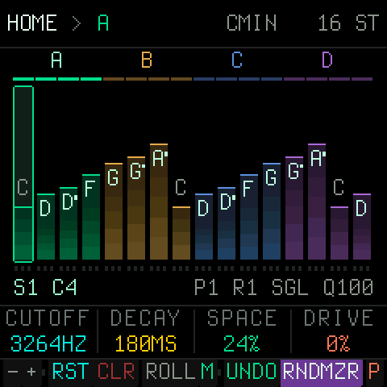 | HOME | HOME | — | `- + RST CLR ROLL M UNDO RNDMZR P` | CUTOFF 3264HZ · DECAY 180MS · SPACE 24% · DRIVE 0% |
| 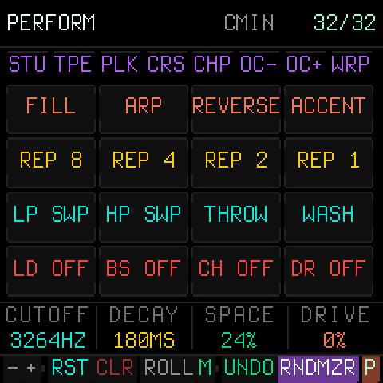 | PERFORM | B10 PERF | — | `- + RST CLR ROLL M UNDO RNDMZR P` | the page's K1-K4; the white keys: FILL, ARP, REVERSE, ACCENT, REP 8, REP 4, REP 2, REP 1, LP SWP, HP SWP, THROW, WASH, LD OFF, BS OFF, CH OFF, DR OFF; the black keys B0-B7, held: STUT, TAPE, PLCK, CRSH, CHOP, OCT-, OCT+, WARP (K1 the held one's amount) |
| 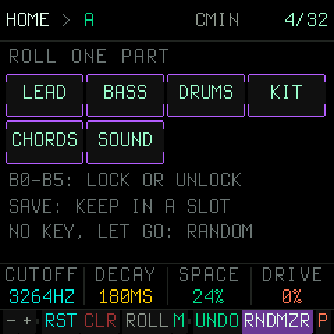 | RNDMZR held | hold RNDMZR | — | `- + RST CLR ROLL M UNDO RNDMZR P` | the page's K1-K4; the white keys roll one part: LEAD, BASS, DRUMS, KIT, CHORDS, SOUND; B0-B5 lock or unlock them; SAVE keeps the band in the first free slot |
|  | — | UNDO held | hold UNDO | — | `- + RST CLR M UNDO RNDMZR P` | the white keys 1-3: the band before the last, second last and third last roll |
|  | — | REC held | hold REC | — | `- + RST CLR M UNDO RNDMZR P` | white keys 1-4: what a take records, SEQ, BASS, CHORD, DRUMS; B0: the click (and a bar's count-in); let go after half a second with neither: the take from empty |
| 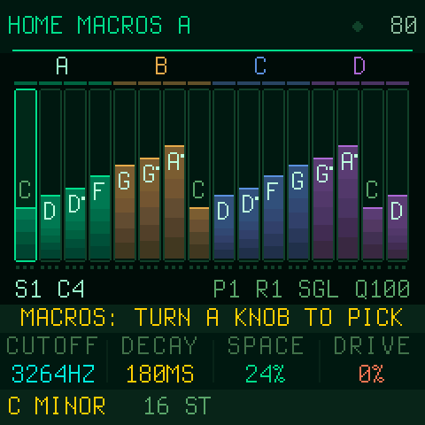 | HOME | hold EDIT | MACROS | `- + RST CLR ROLL M UNDO RNDMZR P` | each knob picks what it turns (CUTOFF, RES, DECAY, ATTACK, RELEASE, SPACE, DRIVE, DELAY, FDBK, REVERB, SIZE, LFO HZ, LFO AMT, PWM, NOISE, DETUNE, OSC 2, FM, SAT, MODENV, SUB LVL, LEAD, BASS, CHORD, DRUMS, SWING) |
| 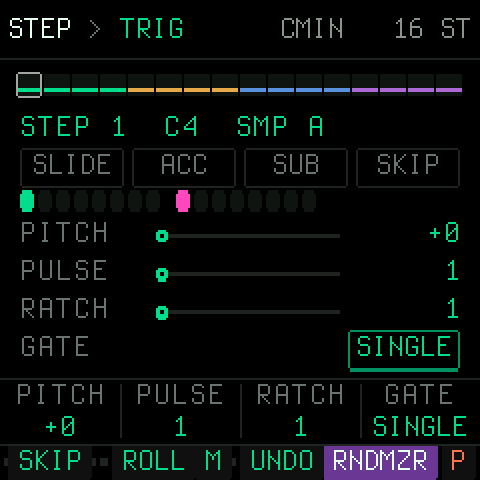 | STEP | SEQ | TRIG | `SKIP ROLL M UNDO RNDMZR P` | PITCH +0 · PULSE 1 · RATCH 1 · GATE SINGLE |
| 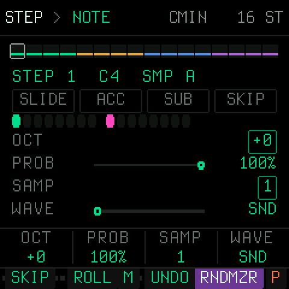 | STEP | SEQ | NOTE | `SKIP ROLL M UNDO RNDMZR P` | OCT +0 · PROB 100% · SAMP 1 · WAVE SND |
| 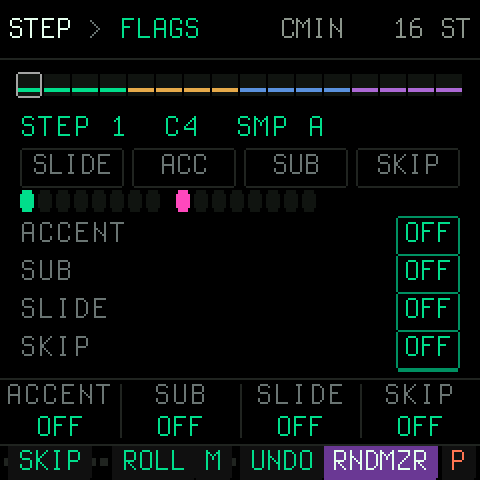 | STEP | SEQ | FLAGS | `SKIP ROLL M UNDO RNDMZR P` | ACCENT OFF · SUB OFF · SLIDE OFF · SKIP OFF |
| 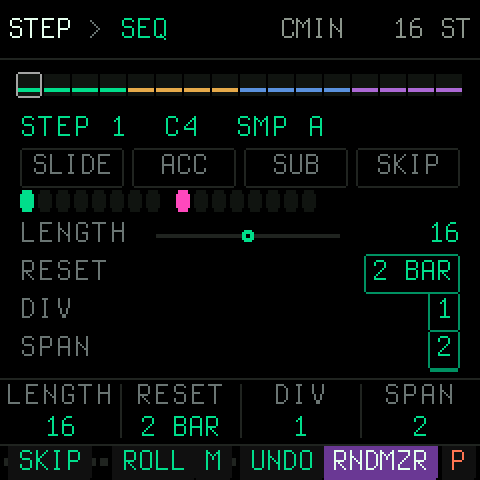 | STEP | SEQ | SEQ | `SKIP ROLL M UNDO RNDMZR P` | LENGTH 16 · RESET 2 BAR · DIV 1 · SPAN 2 |
| 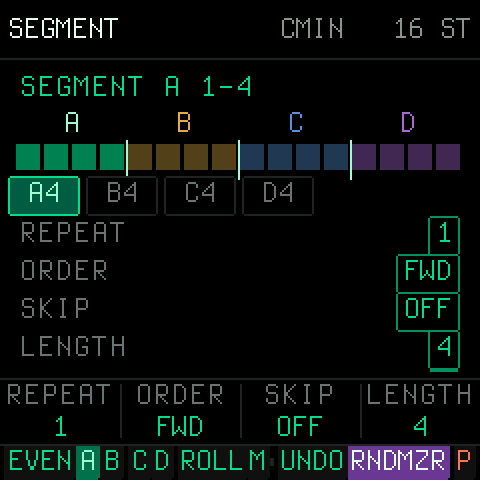 | SEGMENT | SEQ | SEGMENT | `EVEN A B C D ROLL M UNDO RNDMZR P` | REPEAT 1 · ORDER FWD · SKIP OFF · LENGTH 4 |
|  | SEGMENT | SEQ | (2) | `EVEN A B C D ROLL M UNDO RNDMZR P` | REPEAT 1 · ORDER FWD · SKIP OFF · LENGTH 4 |
| 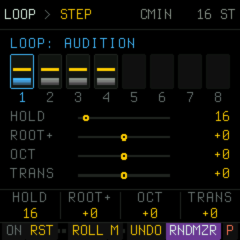 | LOOP CYCLE | SEQ | STEP | `ON RST ROLL M UNDO RNDMZR P` | HOLD 16 · ROOT+ +0 · OCT +0 · TRANS +0 |
| 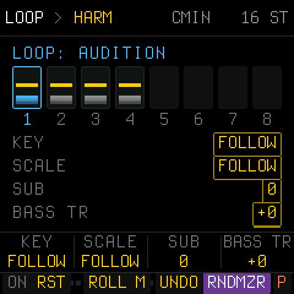 | LOOP CYCLE | SEQ | HARM | `ON RST ROLL M UNDO RNDMZR P` | KEY FOLLOW · SCALE FOLLOW · SUB 0 · BASS TR +0 |
| 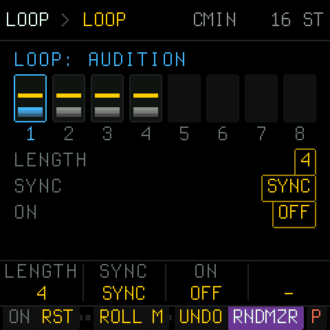 | LOOP CYCLE | SEQ | LOOP | `ON RST ROLL M UNDO RNDMZR P` | LENGTH 4 · SYNC SYNC · ON OFF · — |
| 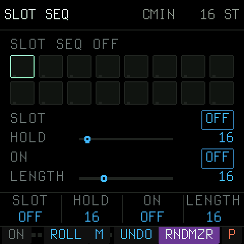 | SLOT SEQ | SEQ | — | `ON ROLL M UNDO RNDMZR P` | SLOT OFF · HOLD 16 · ON OFF · LENGTH 16 |
| 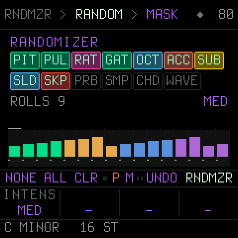 | RANDOM | hold RNDMZR | MASK | `NONE ALL CLR MUT UNDO RNDMZR PERF` | INTENS MED · STYLE ANY · ROLLS ALL · — |
| 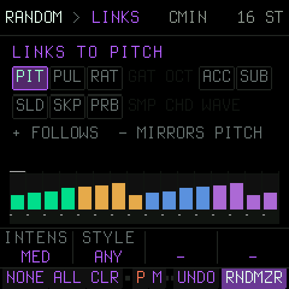 | RANDOM | hold RNDMZR | LINKS | `NONE ALL CLR MUT UNDO RNDMZR PERF` | INTENS MED · STYLE ANY · ROLLS ALL · — |
| 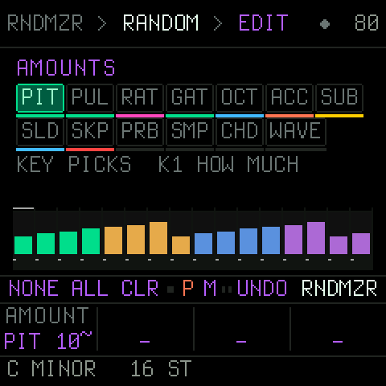 | RANDOM | hold RNDMZR | AMOUNTS | `NONE ALL CLR MUT UNDO RNDMZR PERF` | AMOUNT PIT 10~ · — · — · — |
| 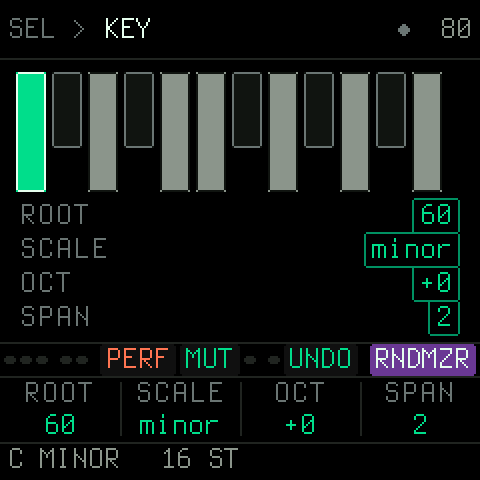 | KEY / SCALE | SEL | — | `MUT UNDO RNDMZR PERF` | ROOT C4 · SCALE minor · OCT +0 · SPAN 2 |
| 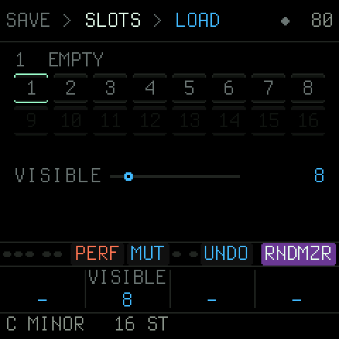 | SLOTS | hold SAVE | LOAD | `MUT UNDO RNDMZR PERF` | — · VISIBLE 8 · — · — |
| 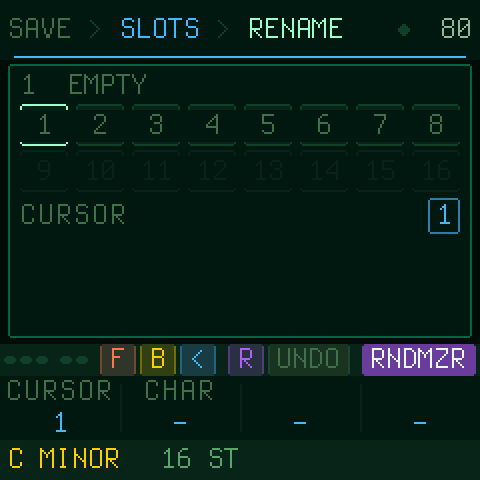 | SLOTS | hold SAVE | RENAME | `MUT UNDO RNDMZR PERF` | CURSOR 1 · CHAR - · — · — |
| 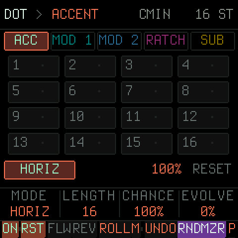 | DOT MATRIX | LFO | ACCENT | `ON RST FLW REV ROLL M UNDO RNDMZR P` | MODE HORIZ · LENGTH 16 · CHANCE 100% · EVOLVE 0% |
| 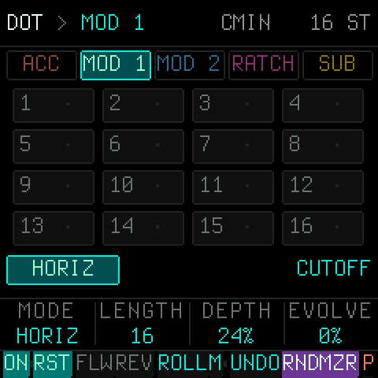 | DOT MATRIX | LFO | MOD 1 | `ON RST FLW REV ROLL M UNDO RNDMZR P` | MODE HORIZ · LENGTH 16 · DEPTH 24% · EVOLVE 0% |
| 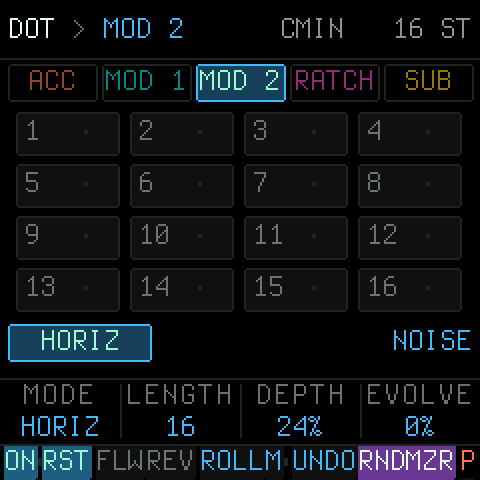 | DOT MATRIX | LFO | MOD 2 | `ON RST FLW REV ROLL M UNDO RNDMZR P` | MODE HORIZ · LENGTH 16 · CHANCE 100% · EVOLVE 0% |
| 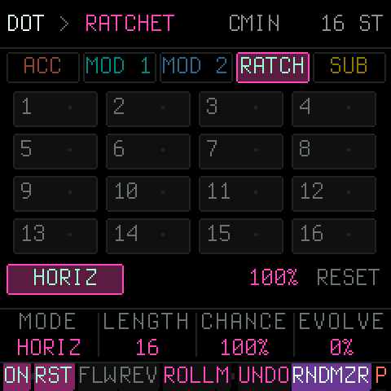 | DOT MATRIX | LFO | RATCHET | `ON RST FLW REV ROLL M UNDO RNDMZR P` | MODE HORIZ · LENGTH 16 · CHANCE 100% · EVOLVE 0% |
| 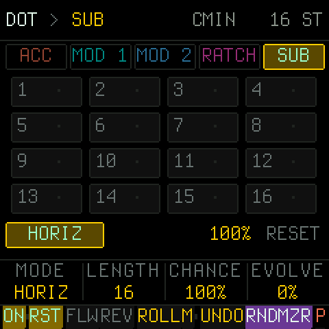 | DOT MATRIX | LFO | SUB | `ON RST FLW REV ROLL M UNDO RNDMZR P` | MODE HORIZ · LENGTH 16 · DEPTH 24% · EVOLVE 0% |
| 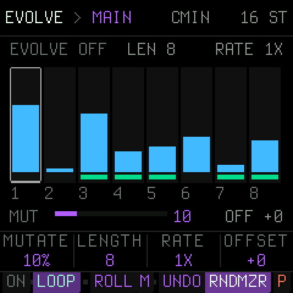 | EVOLVE | LFO | MAIN | `ON LOOP ROLL M UNDO RNDMZR P` | MUTATE 10% · LENGTH 8 · RATE 1X · OFFSET +0 |
|  | EVOLVE | LFO | ROUTES | `ON LOOP ROLL M UNDO RNDMZR P` | GATE LENGTH · FILTER OFF · OCT OFF · DECAY OFF |
| 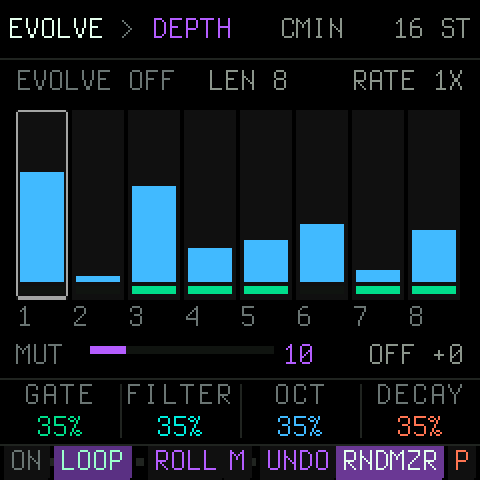 | EVOLVE | LFO | DEPTH | `ON LOOP ROLL M UNDO RNDMZR P` | GATE 35% · FILTER 35% · OCT 35% · DECAY 35% |
| 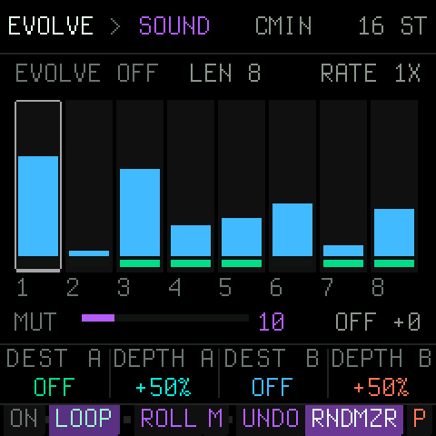 | EVOLVE | LFO | SOUND | `ON LOOP ROLL M UNDO RNDMZR P` | DEST A OFF · DEPTH A +50% · DEST B OFF · DEPTH B +50% |
| 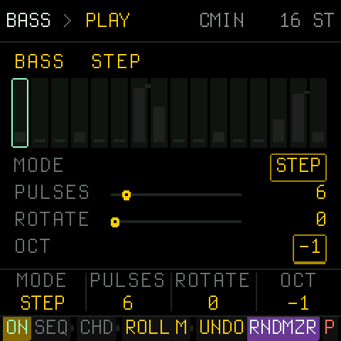 | BASS | ARP | PLAY | `ON SEQ CHD ROLL M UNDO RNDMZR P` | MODE STEP · PULSES 6 · ROTATE 0 · OCT -1 |
| 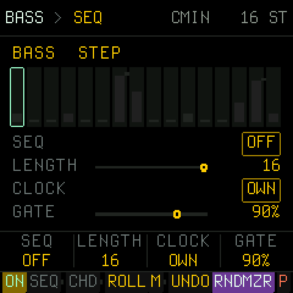 | BASS | ARP | SEQ | `ON SEQ CHD ROLL M UNDO RNDMZR P` | SEQ OFF · LENGTH 16 · CLOCK OWN · GATE 90% |
| 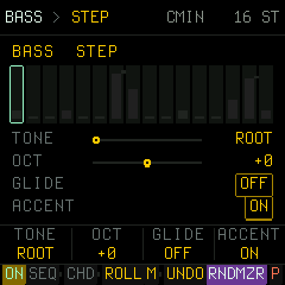 | BASS | ARP | STEP | `ON SEQ CHD ROLL M UNDO RNDMZR P` | TONE ROOT · OCT +0 · GLIDE OFF · ACCENT ON |
| 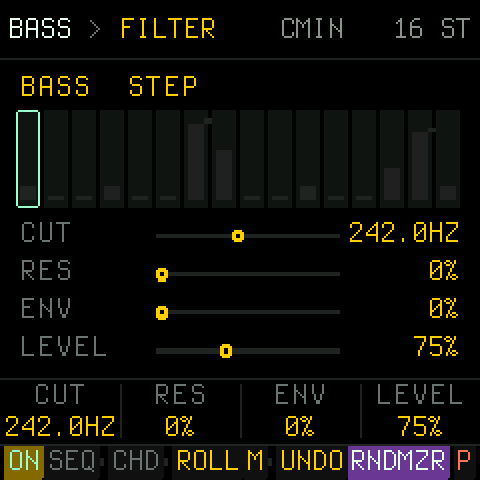 | BASS | ARP | FILTER | `ON SEQ CHD ROLL M UNDO RNDMZR P` | CUT 242.0HZ · RES 0% · ENV 0% · LEVEL 75% |
| 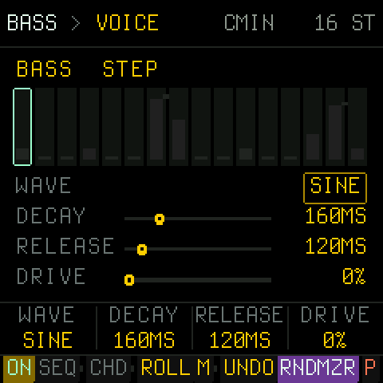 | BASS | ARP | VOICE | `ON SEQ CHD ROLL M UNDO RNDMZR P` | WAVE SINE · DECAY 160MS · RELEASE 120MS · DRIVE 0% |
| 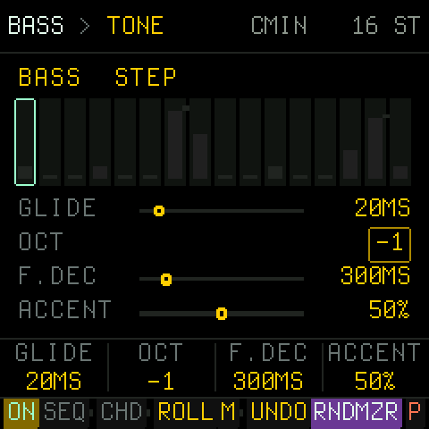 | BASS | ARP | TONE | `ON SEQ CHD ROLL M UNDO RNDMZR P` | GLIDE 20MS · OCT -1 · F.DEC 300MS · ACCENT 50% |
| 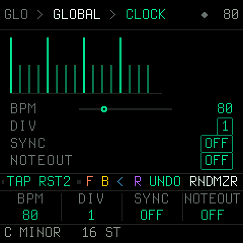 | GLOBAL | GLO | CLOCK | `TAP RST2 MUT UNDO RNDMZR PERF` | BPM 80 · DIV 1 · SYNC OFF · NOTEOUT OFF |
| 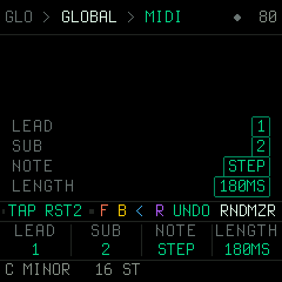 | GLOBAL | GLO | MIDI | `TAP RST2 MUT UNDO RNDMZR PERF` | LEAD 1 · SUB 2 · NOTE STEP · LENGTH 180MS |
| 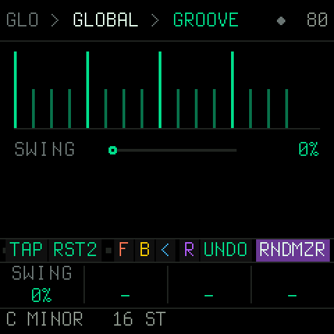 | GLOBAL | GLO | GROOVE | `TAP RST2 MUT UNDO RNDMZR PERF` | SWING 0% · LEAD GLOBAL · BASS GLOBAL · DRUMS GLOBAL |
| 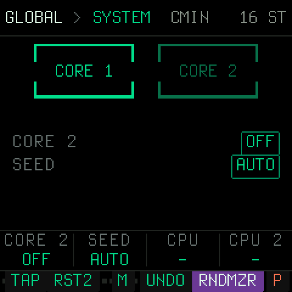 | GLOBAL | GLO | SYSTEM | `TAP RST2 MUT UNDO RNDMZR PERF` | CORE 2 OFF · SEED AUTO · CPU nn% · CPU 2 nn% |
| 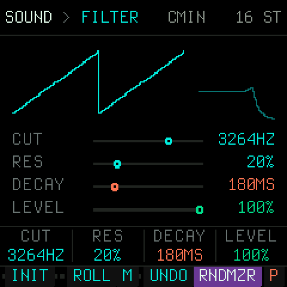 | SOUND | ENV | FILTER | `INIT ROLL M UNDO RNDMZR P` | CUT 3264HZ · RES 20% · DECAY 180MS · LEVEL 100% |
| 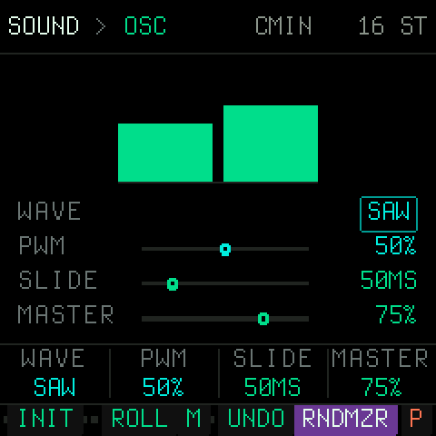 | SOUND | ENV | OSC | `INIT ROLL M UNDO RNDMZR P` | WAVE SAW · PWM 50% · SLIDE 50MS · MASTER 75% |
| 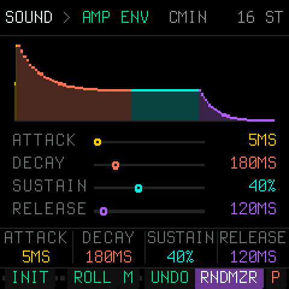 | SOUND | ENV | AMP ENV | `INIT ROLL M UNDO RNDMZR P` | ATTACK 5MS · DECAY 180MS · SUSTAIN 40% · RELEASE 120MS |
| 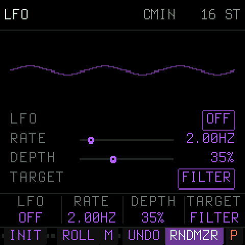 | SOUND | ENV | LFO | `INIT ROLL M UNDO RNDMZR P` | LFO OFF · RATE 2.00HZ · DEPTH 35% · TARGET FILTER |
| 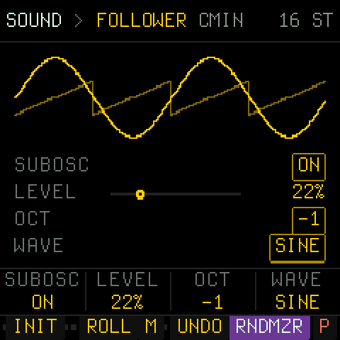 | SOUND | ENV | FOLLOWER | `INIT ROLL M UNDO RNDMZR P` | SUBOSC ON · LEVEL 22% · OCT -1 · WAVE SINE |
| 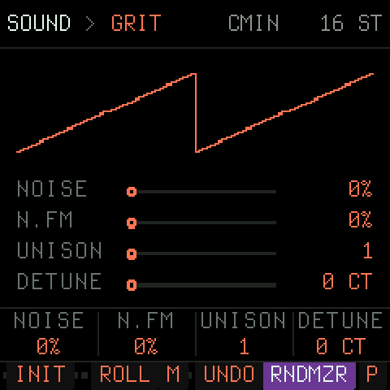 | SOUND | ENV | GRIT | `INIT ROLL M UNDO RNDMZR P` | NOISE 0% · N.FM 0% · UNISON 1 · DETUNE 0 CT |
| 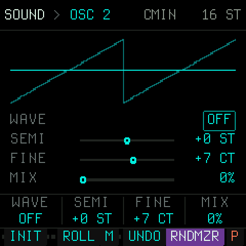 | SOUND | ENV | OSC 2 | `INIT ROLL M UNDO RNDMZR P` | WAVE OFF · SEMI +0 ST · FINE +7 CT · MIX 0% |
| 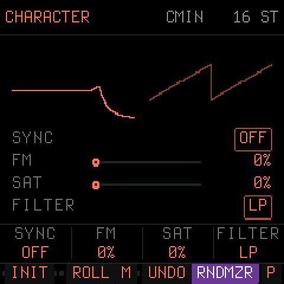 | SOUND | ENV | CHARACTER | `INIT ROLL M UNDO RNDMZR P` | SYNC OFF · FM 0% · SAT 0% · FILTER LP |
| 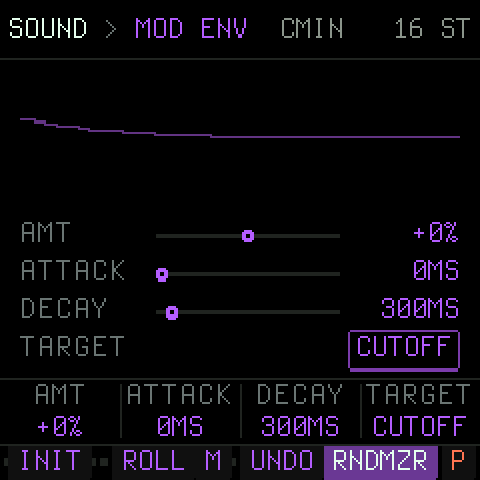 | SOUND | ENV | MOD ENV | `INIT ROLL M UNDO RNDMZR P` | AMT +0% · ATTACK 0MS · DECAY 300MS · TARGET CUTOFF |
| 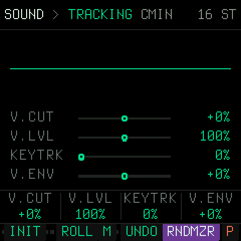 | SOUND | ENV | TRACKING | `INIT ROLL M UNDO RNDMZR P` | V.CUT +0% · V.LVL 100% · KEYTRK 0% · V.ENV +0% |
| 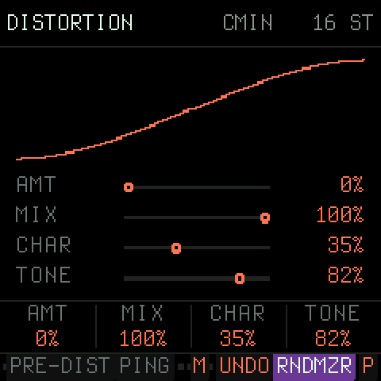 | AUDIO FX | FX | DISTORTION | `PRE-DIST PING M UNDO RNDMZR P` | AMT 0% · MIX 100% · CHAR 35% · TONE 82% |
| 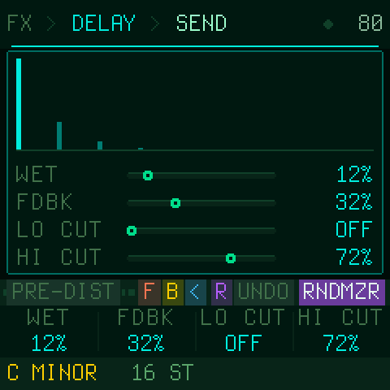 | AUDIO FX | FX | DELAY SEND | `PRE-DIST PING M UNDO RNDMZR P` | WET 12% · FDBK 32% · LO CUT 120HZ · HI CUT 72% |
| 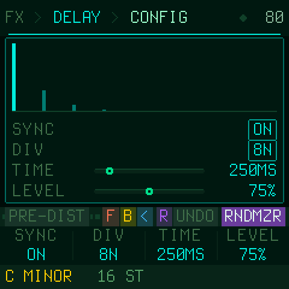 | AUDIO FX | FX | DELAY CONFIG | `PRE-DIST PING M UNDO RNDMZR P` | SYNC ON · DIV 8N · TIME 250MS · LEVEL 75% |
|  | AUDIO FX | FX | DELAY LOOP | `PRE-DIST PING M UNDO RNDMZR P` | GLIDE OFF · PITCH OFF · DIFFUSE 0% · FREEZE OFF |
|  | AUDIO FX | FX | DELAY ROUTE | `PRE-DIST PING M UNDO RNDMZR P` | REVERB 0% · - · - · - |
|  | AUDIO FX | FX | REVERB ROOM | `PRE-DIST PING M UNDO RNDMZR P` | WET 24% · SIZE 70% · DECAY 2.5S · TONE 62% |
|  | AUDIO FX | FX | REVERB RETURNS | `PRE-DIST PING M UNDO RNDMZR P` | PRE 12MS · LEVEL 115% · D.LEVEL 90% · TRIM 0 DB |
|  | AUDIO FX | FX | REVERB OLIVERB | `PRE-DIST PING M UNDO RNDMZR P` | DIFFUSE 65% · SWING 10% · RATE 50% · SHIMMER OFF |
|  | SAMPLE | ENV | MAIN | `ON MUT UNDO RNDMZR PERF` | LEVEL 70% · DIST 0% · TRACK ON · LOOP OFF |
|  | SAMPLE | ENV | PITCH | `ON MUT UNDO RNDMZR PERF` | COARSE +0 · FINE +0 · LEVEL 70% · DIST 0% |
|  | SAMPLE | ENV | TRIM | `ON MUT UNDO RNDMZR PERF` | START 0% · END 100% · TRACK ON · LOOP OFF |
|  | SAMPLE | ENV | ENVELOPE | `ON MUT UNDO RNDMZR PERF` | ATTACK 5MS · DECAY 120MS · SUSTAIN 70% · RELEASE 150MS |
|  | DRUMS | ARP | VOICE | `ON VOX ACC ROLL M UNDO RNDMZR P` | TONE 25% · TUNE 40% · DECAY 335MS · LEVEL 90% |
|  | DRUMS | ARP | STEP | `ON VOX ACC ROLL M UNDO RNDMZR P` | PITCH +0 ST · DECAY +0% · CRUSH 0% · RATCH 1 |
|  | DRUMS | ARP | VARY | `ON VOX ACC ROLL M UNDO RNDMZR P` | CHANCE 100% · CRUSH 0% · FEED OFF · ROLL 50% |
|  | DRUMS | ARP | KIT | `ON VOX ACC ROLL M UNDO RNDMZR P` | LENGTH 16 · CLOCK OWN · — · LEVEL 95% |
|  | DRUMS | ARP | DIST | `ON VOX ACC ROLL M UNDO RNDMZR P` | DRIVE 0% · FOLD 0% · DUCK 0% · — |
|  | DRUMS | ARP | LINE | `ON VOX ACC ROLL M UNDO RNDMZR P` | V.LEN KIT · DIR FWD · RESTART FREE · — |
|  | CHORD | ARP | PLAY | `ON BASS POLY FIT RL M UNDO RNDMZR P` | MODE BROKEN · TRIG STEP · CHORDS 1 · GATE 72% |
|  | CHORD | ARP | CHORD | `ON BASS POLY FIT RL M UNDO RNDMZR P` | DEG 1 · SHAPE TRIAD · HOLD 8 · OCT -1 |
|  | CHORD | ARP | VOICING | `ON BASS POLY FIT RL M UNDO RNDMZR P` | INV 0 · SPREAD 1 · VOICES 3 · VLEAD OFF |
|  | CHORD | ARP | GRID | `ON BASS POLY FIT RL M UNDO RNDMZR P` | MODE HORIZ · LENGTH 16 · DEPTH 100% · FOLLOW OFF |
|  | CHORD | ARP | PATTERN | `ON BASS POLY FIT RL M UNDO RNDMZR P` | MASK 1 · LENGTH 8 · — · — |
|  | CHORD | ARP | FILTER | `ON BASS POLY FIT RL M UNDO RNDMZR P` | CUT 783.0HZ · RES 18% · ENV 22% · LEVEL 13% |
|  | CHORD | ARP | TONE | `ON BASS POLY FIT RL M UNDO RNDMZR P` | WAVE SAW · — · LINK OFF · — |
|  | CHORD | ARP | MOTION | `ON BASS POLY FIT RL M UNDO RNDMZR P` | F.ATK 8MS · F.DEC 700MS · — · NEXT STEPS |
|  | CHORD | ARP | AMP | `ON BASS POLY FIT RL M UNDO RNDMZR P` | ATTACK 40MS · DECAY 900MS · SUSTAIN 75% · RELEASE 900MS |
|  | CHORD | ARP | HARMONY | `ON BASS POLY FIT RL M UNDO RNDMZR P` | FOLLOW OFF · DRIFT 0% · DEPTH ALL · — |
|  | MIX | GLO | LEVEL | `LD BS CH DR MUT UNDO RNDMZR PERF` | LEAD 100% · BASS 75% · CHORD 13% · DRUMS 95% |
|  | MIX | GLO | DELAY | `LD BS CH DR MUT UNDO RNDMZR PERF` | LEAD 100% · BASS 0% · CHORD 60% · DRUMS 25% |
|  | MIX | GLO | REVERB | `LD BS CH DR MUT UNDO RNDMZR PERF` | LEAD 100% · BASS 20% · CHORD 60% · DRUMS 25% |

## White keys

| Page | A white key |
|---|---|
| HOME | Tap: the step on or off. Hold: the step's values on K1-K4, the first four black keys its flags. EDIT (KEYS): a keyboard, lit by the scale; REC cycles what it writes (SEQ, BASS, CHORD). |
| STEP | Picks the step (a tap toggles it too); EDIT on: a key sets its pitch. |
| SEGMENT | Cuts or joins a segment at that step; SEL held: picks the segment. |
| LOOP CYCLE | Picks a loop position (the first eight keys); off, auditions it. |
| SLOT SEQ | Picks a position. |
| RANDOM | A target on or off (MASK; the key after them is BAND: off, a tap of RNDMZR rolls the lead alone), + / - (LINKS), picks the target (AMOUNTS). |
| KEY / SCALE | The root. |
| SLOTS | Picks a slot. |
| DOT MATRIX | A cell on or off. |
| EVOLVE | Flips a bit and picks it. |
| BASS | A BASS SEQ step on or off, and picks it. |
| CHORD | Picks a chord of the chain (or a pattern step). |
| GLOBAL, SOUND, FX, MIX | Nothing. |
| SAMPLE | Picks a slot. |
| DRUMS | The picked voice's hit on or off at that step, and picks the step. |

